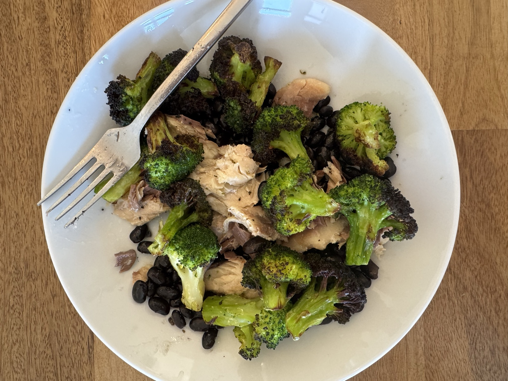

## Steps

1. Air fry the frozen broccoli at 400°F for 12 minutes.
2. Plate with the beans and mackerel.

## Prep ahead

Rehydrate and cook the beans in a batch. About 1/3 cup dried makes 1 cup cooked.

## Notes

Nutrition assumes the mackerel is drained. Keeping the oil adds calories and fat.
