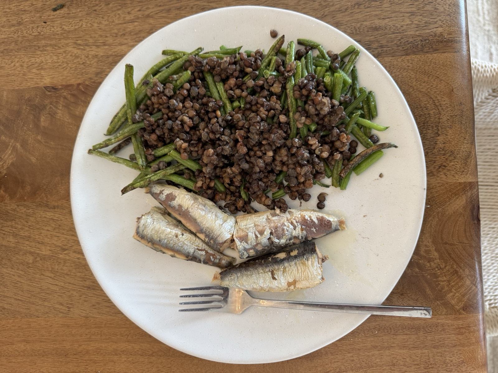

## Steps

1. Air fry the frozen green beans at 400°F for 12 minutes, shaking halfway. Give them a few more minutes if you want more browning.
2. Warm the lentils in a small pan while the beans cook.
3. Plate the beans and lentils with the sardines.

## Prep ahead

Cook the lentils in a batch, or use a precooked pouch and skip this.

## Notes

Nutrition assumes sardines packed in oil and drained. Keeping the oil adds calories and fat.
